

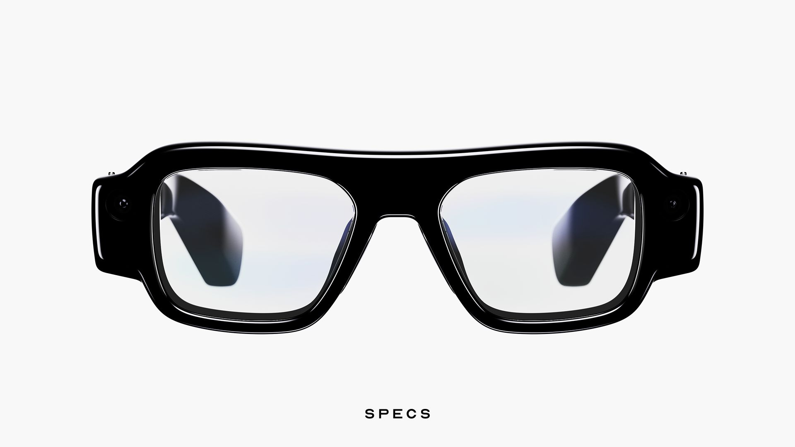

# SPECS

**The official GitHub for SPECS**

*Where you can find the best projects to start your AR developer journey. Let's build the future.*

---

## Getting Started

Before you begin developing for SPECS, make sure you have the required tools installed:

**Required Software:**
- **[Lens Studio](https://ar.snap.com/spectacles)** - Snap's free AR development platform for creating SPECS experiences
- **[Companion App (Android)](https://play.google.com/store/apps/details?id=com.snap.spectacles.app&hl=en_US)** - Companion app for Android devices
- **[Companion App (iOS)](https://apps.apple.com/us/app/spectacles-by-snap-inc/id6502670261)** - Companion app for iOS devices

---

## About

SPECS is the official GitHub organization for SPECS development resources. We provide open-source samples, packages, frameworks and documentation to help developers build amazing AR experiences for SPECS.

Whether you're creating your first AR lens or developing complex spatial applications, we offer the resources and community support you need to succeed.

---

## Repositories

| Repository | What it is | Latest release |
|:--|:--|:--|
| **[samples](https://github.com/specs-devs/samples)** | Ready-to-use Lens Studio projects | [5.25.0](https://github.com/specs-devs/samples/releases/tag/5.25.0) |
| **[packages](https://github.com/specs-devs/packages)** | Asset packages and utilities | [5.25.0](https://github.com/specs-devs/packages/releases/tag/5.25.0) |
| **[core-frameworks](https://github.com/specs-devs/core-frameworks)** | Interaction Kit, UI Kit, Motion, Sync Kit and Leaf | [5.25.0](https://github.com/specs-devs/core-frameworks/releases/tag/5.25.0) |
| **[icons](https://github.com/specs-devs/icons)** | The SPECS icon library | [5.25.0](https://github.com/specs-devs/icons/releases/tag/5.25.0) |
| **[ndk](https://github.com/specs-devs/ndk)** | SPECS NDK version manifest | [1.1.1](https://github.com/specs-devs/ndk/releases/tag/1.1.1) |

## Releases

Each repository keeps one branch per Lens Studio release. `main` always carries the latest.

| Branch | Lens Studio | Device | Repositories |
|:--|:--|:--|:--|
| `main` | 5.25.0 | SPECS 27 | samples, packages, core-frameworks, icons |
| `5.24.1` | 5.24.1 | SPECS 27 | samples, packages |
| `5.24` | 5.24.0 | SPECS 27 | samples, packages |
| `5.22` | 5.22.0 | SPECS 27 | samples, packages |
| `5.15.4` | 5.15.4 | Spectacles (2024) | samples, packages |

> [!IMPORTANT]
> **Spectacles (2024) is supported only on `5.15.4`.** Use the `5.15.4` branch / release of each repo.
> **Everything `5.22.0`+ targets SPECS 27.** Links on this page point at `main` (5.25.0) and won't work with Spectacles (2024).

---

## Samples Repository

Ready-to-use project templates and sample applications demonstrating SPECS capabilities. Clone individual projects using sparse checkout:

<table>
<tbody>
<tr>
<th>Preview</th>
<th>Title</th>
<th>Description</th>
<th>Clone Command</th>
</tr>
<tr>
<td align="center"></td>
<td align="center"><a href="https://github.com/specs-devs/samples/tree/main/AI%20Playground">AI Playground</a></td>
<td>Sample project for AI in using SPECS Remote Service Gateway.</td>
<td><code>git clone --filter=blob:none --sparse https://github.com/specs-devs/samples.git cd samples && git sparse-checkout add "AI Playground"</code></td>
</tr>
<tr>
<td align="center"></td>
<td align="center"><a href="https://github.com/specs-devs/samples/tree/main/Crop">Crop</a></td>
<td>Sample project showing how to "crop" the environment using hand gesture.</td>
<td><code>git clone --filter=blob:none --sparse https://github.com/specs-devs/samples.git cd samples && git sparse-checkout add "Crop"</code></td>
</tr>
<tr>
<td align="center"></td>
<td align="center"><a href="https://github.com/specs-devs/samples/tree/main/Depth%20Cache">Depth Cache</a></td>
<td>Cache depth frames for pixel-to-3D projection with cloud-based vision models.</td>
<td><code>git clone --filter=blob:none --sparse https://github.com/specs-devs/samples.git cd samples && git sparse-checkout add "Depth Cache"</code></td>
</tr>
<tr>
<td align="center"></td>
<td align="center"><a href="https://github.com/specs-devs/samples/tree/main/AI%20Music%20Gen">AI Music Gen</a></td>
<td>Generate AI music using Google's Lyria model. Combine genres, vibes, and instruments to create custom music tracks with 3D visualizations.</td>
<td><code>git clone --filter=blob:none --sparse https://github.com/specs-devs/samples.git cd samples && git sparse-checkout add "AI Music Gen"</code></td>
</tr>
<tr>
<td align="center"></td>
<td align="center"><a href="https://github.com/specs-devs/samples/tree/main/Agent%20Manager">Agent Manager</a></td>
<td>Multi-agent assistant hub for SPECS—run and manage multiple AI agents with text and voice input.</td>
<td><code>git clone --filter=blob:none --sparse https://github.com/specs-devs/samples.git cd samples && git sparse-checkout add "Agent Manager"</code></td>
</tr>
<tr>
<td align="center"></td>
<td align="center"><a href="https://github.com/specs-devs/samples/tree/main/Fetch">Fetch</a></td>
<td>Sample project using the SPECS Fetch API.</td>
<td><code>git clone --filter=blob:none --sparse https://github.com/specs-devs/samples.git cd samples && git sparse-checkout add "Fetch"</code></td>
</tr>
<tr>
<td align="center"></td>
<td align="center"><a href="https://github.com/specs-devs/samples/tree/main/Essentials">Essentials</a></td>
<td>Collection of foundational concepts for creating lenses in Lens Studio.</td>
<td><code>git clone --filter=blob:none --sparse https://github.com/specs-devs/samples.git cd samples && git sparse-checkout add "Essentials"</code></td>
</tr>
<tr>
<td align="center"></td>
<td align="center"><a href="https://github.com/specs-devs/samples/tree/main/Throw%20Lab">Throw Lab</a></td>
<td>Sample project demonstrating realistic throwing mechanics in AR.</td>
<td><code>git clone --filter=blob:none --sparse https://github.com/specs-devs/samples.git cd samples && git sparse-checkout add "Throw Lab"</code></td>
</tr>
<tr>
<td align="center"></td>
<td align="center"><a href="https://github.com/specs-devs/samples/tree/main/Voice%20Playback">Voice Playback</a></td>
<td>Sample project for recording and playing back audio on SPECS.</td>
<td><code>git clone --filter=blob:none --sparse https://github.com/specs-devs/samples.git cd samples && git sparse-checkout add "Voice Playback"</code></td>
</tr>
<tr>
<td align="center"></td>
<td align="center"><a href="https://github.com/specs-devs/samples/tree/main/Path%20Pioneer">Path Pioneer</a></td>
<td>Sample project for path creation and path walking experience.</td>
<td><code>git clone --filter=blob:none --sparse https://github.com/specs-devs/samples.git cd samples && git sparse-checkout add "Path Pioneer"</code></td>
</tr>
<tr>
<td align="center"></td>
<td align="center"><a href="https://github.com/specs-devs/samples/tree/main/Mobile%20Kit">Mobile Kit</a></td>
<td>SDK for seamless communication between mobile applications and Lenses running on SPECS via BLE.</td>
<td><code>git clone --filter=blob:none --sparse https://github.com/specs-devs/samples.git cd samples && git sparse-checkout add "Mobile Kit"</code></td>
</tr>
<tr>
<td align="center"></td>
<td align="center"><a href="https://github.com/specs-devs/samples/tree/main/DJ">DJ</a></td>
<td>Interactive DJ turntable experience with realistic vinyl physics and multi-track audio mixing.</td>
<td><code>git clone --filter=blob:none --sparse https://github.com/specs-devs/samples.git cd samples && git sparse-checkout add "DJ"</code></td>
</tr>
<tr>
<td align="center"></td>
<td align="center"><a href="https://github.com/specs-devs/samples/tree/main/Industrial%20Sketch">Industrial Sketch</a></td>
<td>Hand-tracked 3D sketching and concept modeling: strokes, surfaces, SubD, symmetry and live co-creation.</td>
<td><code>git clone --filter=blob:none --sparse https://github.com/specs-devs/samples.git cd samples && git sparse-checkout add "Industrial Sketch"</code></td>
</tr>
<tr>
<td align="center"></td>
<td align="center"><a href="https://github.com/specs-devs/samples/tree/main/Custom%20Locations">Custom Locations</a></td>
<td>Map real life areas and create AR experiences around those locations.</td>
<td><code>git clone --filter=blob:none --sparse https://github.com/specs-devs/samples.git cd samples && git sparse-checkout add "Custom Locations"</code></td>
</tr>
<tr>
<td align="center"></td>
<td align="center"><a href="https://github.com/specs-devs/samples/tree/main/Navigation%20Kit">Navigation Kit</a></td>
<td>An example project for indoors or outdoors navigation.</td>
<td><code>git clone --filter=blob:none --sparse https://github.com/specs-devs/samples.git cd samples && git sparse-checkout add "Navigation Kit"</code></td>
</tr>
<tr>
<td align="center"></td>
<td align="center"><a href="https://github.com/specs-devs/samples/tree/main/Sync%20Kit%20Shared%20Sync%20Controls">Shared Sync Controls</a></td>
<td>Real-time collaborative AR experience for shared controls.</td>
<td><code>git clone --filter=blob:none --sparse https://github.com/specs-devs/samples.git cd samples && git sparse-checkout add "Sync Kit Shared Sync Controls"</code></td>
</tr>
<tr>
<td align="center"></td>
<td align="center"><a href="https://github.com/specs-devs/samples/tree/main/Sync%20Kit%20Tic%20Tac%20Toe">Tic Tac Toe</a></td>
<td>Sample Connected Lens project using Sync Kit.</td>
<td><code>git clone --filter=blob:none --sparse https://github.com/specs-devs/samples.git cd samples && git sparse-checkout add "Sync Kit Tic Tac Toe"</code></td>
</tr>
<tr>
<td align="center"></td>
<td align="center"><a href="https://github.com/specs-devs/samples/tree/main/Sync%20Kit%20Laser%20Pointer">Laser Pointer</a></td>
<td>Create laser pointers on a virtual object that are visible to all connected users.</td>
<td><code>git clone --filter=blob:none --sparse https://github.com/specs-devs/samples.git cd samples && git sparse-checkout add "Sync Kit Laser Pointer"</code></td>
</tr>
<tr>
<td align="center"></td>
<td align="center"><a href="https://github.com/specs-devs/samples/tree/main/Sync%20Kit%20High%20Five">High Five</a></td>
<td>Real-time collaborative AR experience for high-five interactions.</td>
<td><code>git clone --filter=blob:none --sparse https://github.com/specs-devs/samples.git cd samples && git sparse-checkout add "Sync Kit High Five"</code></td>
</tr>
<tr>
<td align="center"></td>
<td align="center"><a href="https://github.com/specs-devs/samples/tree/main/Sync%20Kit%20Air%20Hockey">Air Hockey</a></td>
<td>Sample Connected Lens project using Sync Kit.</td>
<td><code>git clone --filter=blob:none --sparse https://github.com/specs-devs/samples.git cd samples && git sparse-checkout add "Sync Kit Air Hockey"</code></td>
</tr>
<tr>
<td align="center"></td>
<td align="center"><a href="https://github.com/specs-devs/samples/tree/main/Sync%20Kit%20Think%20Out%20Loud">Think Out Loud</a></td>
<td>Social AR networking application with floating status panels and real-time connections.</td>
<td><code>git clone --filter=blob:none --sparse https://github.com/specs-devs/samples.git cd samples && git sparse-checkout add "Sync Kit Think Out Loud"</code></td>
</tr>
<tr>
<td align="center"></td>
<td align="center"><a href="https://github.com/specs-devs/samples/tree/main/Sync%20Kit%20Basic%20Example">Sync Kit</a></td>
<td>Minimal example of Sync Kit transform synchronization across Connected Lenses.</td>
<td><code>git clone --filter=blob:none --sparse https://github.com/specs-devs/samples.git cd samples && git sparse-checkout add "Sync Kit Basic Example"</code></td>
</tr>
</tbody>
</table>

Starting a new project? Use the blank templates: [Base Template](https://github.com/specs-devs/samples/tree/main/Base%20Template) and [Base Template With Examples](https://github.com/specs-devs/samples/tree/main/Base%20Template%20With%20Examples).

---

## Packages Repository

Reusable components, utilities, and packages for AR development. The same packages are available from the Lens Studio Asset Library. Clone individual packages using sparse checkout:

<table>
<tbody>
<tr>
<th>Preview</th>
<th>Title</th>
<th>Description</th>
<th>Clone Command</th>
</tr>
<tr>
<td align="center">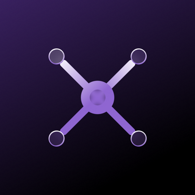</td>
<td align="center"><a href="https://github.com/specs-devs/packages/tree/main/RemoteServiceGateway">Remote Service Gateway</a></td>
<td>A package that provides a set of tools that allow to publish lenses with access to user-sensitive data.</td>
<td><code>git clone --filter=blob:none --sparse https://github.com/specs-devs/packages.git cd packages && git sparse-checkout add "RemoteServiceGateway"</code></td>
</tr>
<tr>
<td align="center">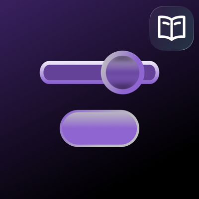</td>
<td align="center"><a href="https://github.com/specs-devs/packages/tree/main/InteractionKitExamples">Interaction Kit Examples</a></td>
<td>Example scenes and prefabs for InteractionKit and UIKit, led by an Interaction Showcase (direct, indirect, poke and pinch interaction) plus UI starter patterns.</td>
<td><code>git clone --filter=blob:none --sparse https://github.com/specs-devs/packages.git cd packages && git sparse-checkout add "InteractionKitExamples"</code></td>
</tr>
<tr>
<td align="center"></td>
<td align="center"><a href="https://github.com/specs-devs/packages/tree/main/CommerceKit">Commerce Kit</a></td>
<td>In-app purchases for SPECS Lenses: non-consumables, consumables and subscriptions defined on the Specs developer portal.</td>
<td><code>git clone --filter=blob:none --sparse https://github.com/specs-devs/packages.git cd packages && git sparse-checkout add "CommerceKit"</code></td>
</tr>
<tr>
<td align="center"></td>
<td align="center"><a href="https://github.com/specs-devs/packages/tree/main/NavigationKit">Navigation Kit</a></td>
<td>Set of components designed to simplify the development of navigation experiences for SPECS.</td>
<td><code>git clone --filter=blob:none --sparse https://github.com/specs-devs/packages.git cd packages && git sparse-checkout add "NavigationKit"</code></td>
</tr>
<tr>
<td align="center">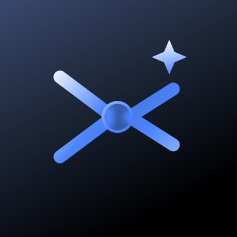</td>
<td align="center"><a href="https://github.com/specs-devs/packages/tree/main/AiPreviewAgentInteract">AI Preview Agent – Interact</a></td>
<td>Lets an external AI agent drive a running Lens by synthesizing pinch, poke, and drag hand interactions for end-to-end agent verification.</td>
<td><code>git clone --filter=blob:none --sparse https://github.com/specs-devs/packages.git cd packages && git sparse-checkout add "AiPreviewAgentInteract"</code></td>
</tr>
<tr>
<td align="center">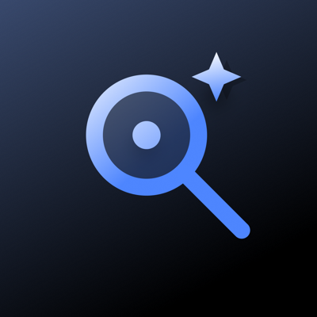</td>
<td align="center"><a href="https://github.com/specs-devs/packages/tree/main/AiPreviewAgentInspect">AI Preview Agent – Inspect</a></td>
<td>Lens-side bridge that lets an external AI agent observe a running Lens through live scene queries and orthographic render captures.</td>
<td><code>git clone --filter=blob:none --sparse https://github.com/specs-devs/packages.git cd packages && git sparse-checkout add "AiPreviewAgentInspect"</code></td>
</tr>
<tr>
<td align="center">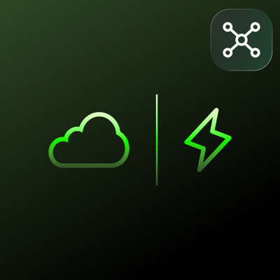</td>
<td align="center"><a href="https://github.com/specs-devs/packages/tree/main/SupabaseClient">Supabase Client</a></td>
<td>Client library for connecting to Supabase backend infrastructure.</td>
<td><code>git clone --filter=blob:none --sparse https://github.com/specs-devs/packages.git cd packages && git sparse-checkout add "SupabaseClient"</code></td>
</tr>
<tr>
<td align="center">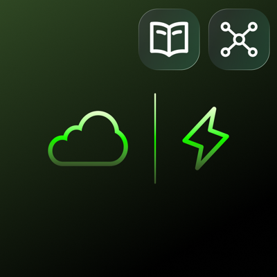</td>
<td align="center"><a href="https://github.com/specs-devs/packages/tree/main/SnapCloudExamples">Snap Cloud Examples</a></td>
<td>Collection of examples demonstrating Supabase integration for authentication, real-time data, and cloud storage.</td>
<td><code>git clone --filter=blob:none --sparse https://github.com/specs-devs/packages.git cd packages && git sparse-checkout add "SnapCloudExamples"</code></td>
</tr>
<tr>
<td align="center"></td>
<td align="center"><a href="https://github.com/specs-devs/packages/tree/main/SnapCloudSocialMedia">Snap Cloud Social Media</a></td>
<td>Prototype prefab and editor plugin for recording and sharing through official social APIs, with JSON presets, captions and destination controls.</td>
<td><code>git clone --filter=blob:none --sparse https://github.com/specs-devs/packages.git cd packages && git sparse-checkout add "SnapCloudSocialMedia"</code></td>
</tr>
<tr>
<td align="center"></td>
<td align="center"><a href="https://github.com/specs-devs/packages/tree/main/SnapCloudConnected">Snap Cloud Connected</a></td>
<td>Multiplayer starting point: pair players with a 4-digit code, place content on a surface per player, and sync object transforms through Snap Cloud.</td>
<td><code>git clone --filter=blob:none --sparse https://github.com/specs-devs/packages.git cd packages && git sparse-checkout add "SnapCloudConnected"</code></td>
</tr>
<tr>
<td align="center"></td>
<td align="center"><a href="https://github.com/specs-devs/packages/tree/main/AuthKit">Auth Kit</a></td>
<td>OAuth2 authentication framework with PKCE, token refresh and deep links.</td>
<td><code>git clone --filter=blob:none --sparse https://github.com/specs-devs/packages.git cd packages && git sparse-checkout add "AuthKit"</code></td>
</tr>
<tr>
<td align="center"></td>
<td align="center"><a href="https://github.com/specs-devs/packages/tree/main/AuthKitExamples">Auth Kit Examples</a></td>
<td>Ready-to-run OAuth2 sign-in examples (Spotify and generic providers) built on Auth Kit.</td>
<td><code>git clone --filter=blob:none --sparse https://github.com/specs-devs/packages.git cd packages && git sparse-checkout add "AuthKitExamples"</code></td>
</tr>
<tr>
<td align="center">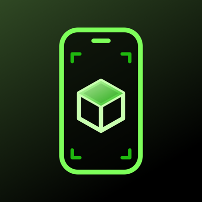</td>
<td align="center"><a href="https://github.com/specs-devs/packages/tree/main/ARKitSpectator">ARKit Spectator</a></td>
<td>Drag-and-drop prefab that streams Lens objects through Snap Cloud to an iPhone app (zipped in the package) so others can watch the scene in AR.</td>
<td><code>git clone --filter=blob:none --sparse https://github.com/specs-devs/packages.git cd packages && git sparse-checkout add "ARKitSpectator"</code></td>
</tr>
<tr>
<td align="center">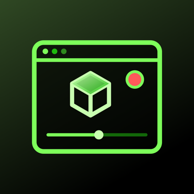</td>
<td align="center"><a href="https://github.com/specs-devs/packages/tree/main/WebCapture">Web Capture</a></td>
<td>Mirror a Lens in your browser, record it while it plays and edit the recording into a video (Lens Studio plugin + web portal, Snap Cloud for Specs).</td>
<td><code>git clone --filter=blob:none --sparse https://github.com/specs-devs/packages.git cd packages && git sparse-checkout add "WebCapture"</code></td>
</tr>
<tr>
<td align="center">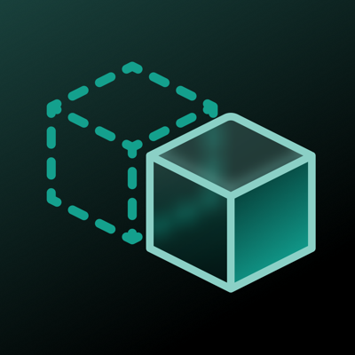</td>
<td align="center"><a href="https://github.com/specs-devs/packages/tree/main/HandHints3D">3D Hints</a></td>
<td>Suite of animated Hand Gestures Hints.</td>
<td><code>git clone --filter=blob:none --sparse https://github.com/specs-devs/packages.git cd packages && git sparse-checkout add "HandHints3D"</code></td>
</tr>
<tr>
<td align="center"></td>
<td align="center"><a href="https://github.com/specs-devs/packages/tree/main/InteractableHelper">Interactable Helper</a></td>
<td>Low to medium fidelity prototyping tool for Interaction Kit components without code.</td>
<td><code>git clone --filter=blob:none --sparse https://github.com/specs-devs/packages.git cd packages && git sparse-checkout add "InteractableHelper"</code></td>
</tr>
<tr>
<td align="center">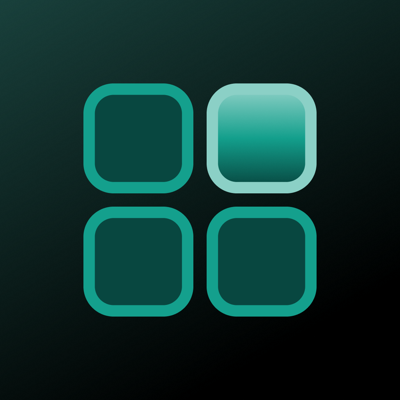</td>
<td align="center"><a href="https://github.com/specs-devs/packages/tree/main/FunctionCallHelper">Function Call Helper</a></td>
<td>System for exposing function callbacks in the inspector, allowing you to configure and trigger script functions through UI buttons.</td>
<td><code>git clone --filter=blob:none --sparse https://github.com/specs-devs/packages.git cd packages && git sparse-checkout add "FunctionCallHelper"</code></td>
</tr>
<tr>
<td align="center">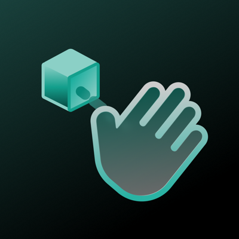</td>
<td align="center"><a href="https://github.com/specs-devs/packages/tree/main/HandAttacher">Hand Attacher</a></td>
<td>Attach objects to hand joints in world space with customizable offsets and smooth interpolation.</td>
<td><code>git clone --filter=blob:none --sparse https://github.com/specs-devs/packages.git cd packages && git sparse-checkout add "HandAttacher"</code></td>
</tr>
<tr>
<td align="center">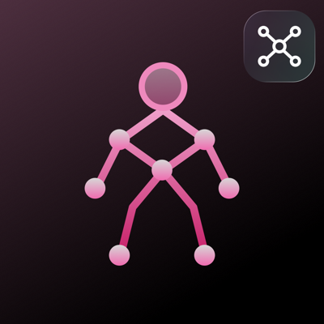</td>
<td align="center"><a href="https://github.com/specs-devs/packages/tree/main/MocopiReceiver">Mocopi Receiver</a></td>
<td>Full-body motion capture integration for Sony mocopi sensors with WebSocket streaming and automatic bone mapping.</td>
<td><code>git clone --filter=blob:none --sparse https://github.com/specs-devs/packages.git cd packages && git sparse-checkout add "MocopiReceiver"</code></td>
</tr>
<tr>
<td align="center">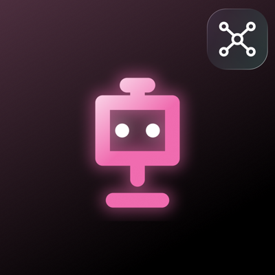</td>
<td align="center"><a href="https://github.com/specs-devs/packages/tree/main/ReachyReceiver">Reachy Receiver</a></td>
<td>Integration for Reachy humanoid robot with WebSocket streaming.</td>
<td><code>git clone --filter=blob:none --sparse https://github.com/specs-devs/packages.git cd packages && git sparse-checkout add "ReachyReceiver"</code></td>
</tr>
<tr>
<td align="center">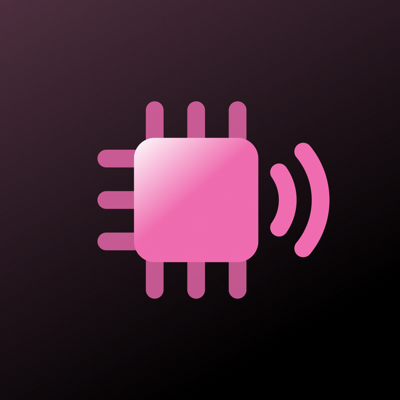</td>
<td align="center"><a href="https://github.com/specs-devs/packages/tree/main/WebSocketExamples">WebSocket Examples</a></td>
<td>WebSocket examples for real-time data exchange including TextEcho, IMUData, and IMUCube.</td>
<td><code>git clone --filter=blob:none --sparse https://github.com/specs-devs/packages.git cd packages && git sparse-checkout add "WebSocketExamples"</code></td>
</tr>
<tr>
<td align="center"></td>
<td align="center"><a href="https://github.com/specs-devs/packages/tree/main/Midi">Midi</a></td>
<td>Parse BLE-MIDI into note, control-change and clock events with reconstructed instrument timing.</td>
<td><code>git clone --filter=blob:none --sparse https://github.com/specs-devs/packages.git cd packages && git sparse-checkout add "Midi"</code></td>
</tr>
<tr>
<td align="center">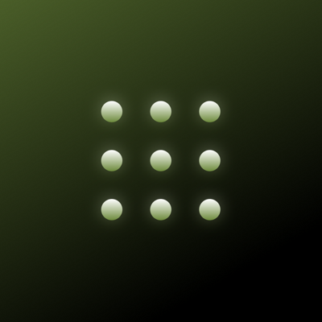</td>
<td align="center"><a href="https://github.com/specs-devs/packages/tree/main/Instantiation">Instantiation</a></td>
<td>Examples for dynamic object creation.</td>
<td><code>git clone --filter=blob:none --sparse https://github.com/specs-devs/packages.git cd packages && git sparse-checkout add "Instantiation"</code></td>
</tr>
<tr>
<td align="center"></td>
<td align="center"><a href="https://github.com/specs-devs/packages/tree/main/Solvers">Solvers</a></td>
<td>Collections of spatial behaviors for Spatial UI or scene objects.</td>
<td><code>git clone --filter=blob:none --sparse https://github.com/specs-devs/packages.git cd packages && git sparse-checkout add "Solvers"</code></td>
</tr>
<tr>
<td align="center">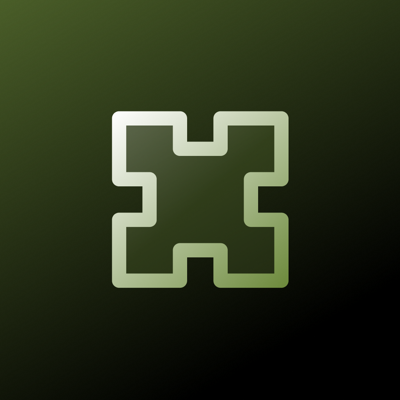</td>
<td align="center"><a href="https://github.com/specs-devs/packages/tree/main/AccessComponents">Access Components</a></td>
<td>Collection of scripts to showcase how to reference and access classes.</td>
<td><code>git clone --filter=blob:none --sparse https://github.com/specs-devs/packages.git cd packages && git sparse-checkout add "AccessComponents"</code></td>
</tr>
<tr>
<td align="center">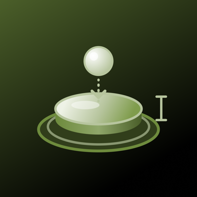</td>
<td align="center"><a href="https://github.com/specs-devs/packages/tree/main/Agnostic3DButton">Agnostic 3D Button</a></td>
<td>One soft-press 3D button for any finger with no physics: hover, press, click, toggle and pressure events, in themed and UIKit looks.</td>
<td><code>git clone --filter=blob:none --sparse https://github.com/specs-devs/packages.git cd packages && git sparse-checkout add "Agnostic3DButton"</code></td>
</tr>
<tr>
<td align="center"></td>
<td align="center"><a href="https://github.com/specs-devs/packages/tree/main/VideoPlayer">Video Player</a></td>
<td>Hardware-decoded video on Specs with the SpecsNDK SpecsPlayer library: files and http(s) streams, audio on the speakers, a ready-made UIKit player panel; VideoTexture fallback in the editor.</td>
<td><code>git clone --filter=blob:none --sparse https://github.com/specs-devs/packages.git cd packages && git sparse-checkout add "VideoPlayer"</code></td>
</tr>
<tr>
<td align="center">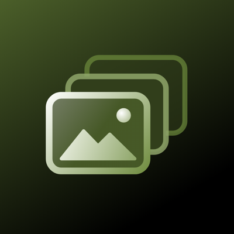</td>
<td align="center"><a href="https://github.com/specs-devs/packages/tree/main/SpatialImage">Spatial Image</a></td>
<td>Turns flat photos into 3D spatial images with the Snap Spatial Image API (Remote Service Gateway): flat placeholder, depth ease-in, angle-based flattening and a gallery.</td>
<td><code>git clone --filter=blob:none --sparse https://github.com/specs-devs/packages.git cd packages && git sparse-checkout add "SpatialImage"</code></td>
</tr>
<tr>
<td align="center"></td>
<td align="center"><a href="https://github.com/specs-devs/packages/tree/main/GuidedInstructions">Guided Instructions</a></td>
<td>Voice-driven, AI-assisted guided AR experiences: speech, depth, Gemini integration, and world-space UI.</td>
<td><code>git clone --filter=blob:none --sparse https://github.com/specs-devs/packages.git cd packages && git sparse-checkout add "GuidedInstructions"</code></td>
</tr>
<tr>
<td align="center">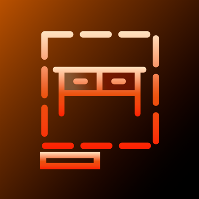</td>
<td align="center"><a href="https://github.com/specs-devs/packages/tree/main/WorldQueryHit">World Query Module</a></td>
<td>Performs hit tests for real-world surfaces.</td>
<td><code>git clone --filter=blob:none --sparse https://github.com/specs-devs/packages.git cd packages && git sparse-checkout add "WorldQueryHit"</code></td>
</tr>
<tr>
<td align="center">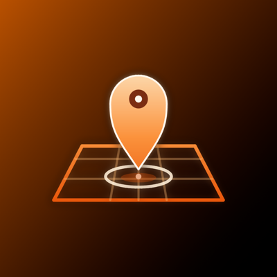</td>
<td align="center"><a href="https://github.com/specs-devs/packages/tree/main/SurfacePlacement">Surface Placement</a></td>
<td>Places content on floors and walls using head pose, with optional pinch/tap and near-surface modes.</td>
<td><code>git clone --filter=blob:none --sparse https://github.com/specs-devs/packages.git cd packages && git sparse-checkout add "SurfacePlacement"</code></td>
</tr>
<tr>
<td align="center">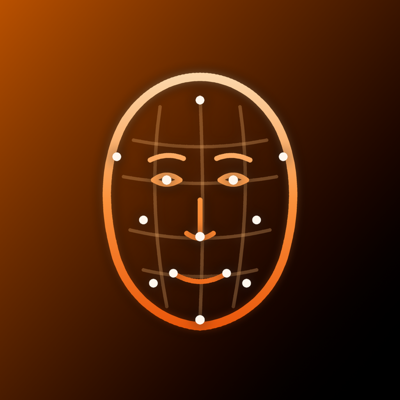</td>
<td align="center"><a href="https://github.com/specs-devs/packages/tree/main/FaceMesh">Face Mesh</a></td>
<td>Face mesh tracking setup with customizable materials and transform matching for smooth tracking motion.</td>
<td><code>git clone --filter=blob:none --sparse https://github.com/specs-devs/packages.git cd packages && git sparse-checkout add "FaceMesh"</code></td>
</tr>
<tr>
<td align="center">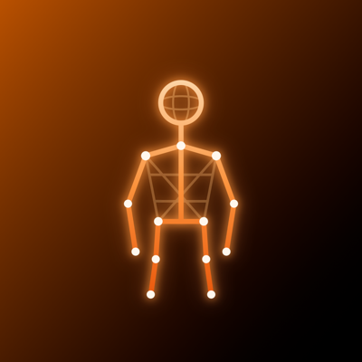</td>
<td align="center"><a href="https://github.com/specs-devs/packages/tree/main/BodyMesh">Body Mesh</a></td>
<td>Body mesh tracking and rigging utilities for full-body AR experiences.</td>
<td><code>git clone --filter=blob:none --sparse https://github.com/specs-devs/packages.git cd packages && git sparse-checkout add "BodyMesh"</code></td>
</tr>
<tr>
<td align="center">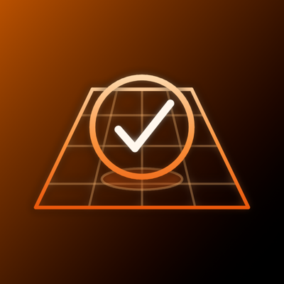</td>
<td align="center"><a href="https://github.com/specs-devs/packages/tree/main/AutoFloorFinder">Auto Floor Finder</a></td>
<td>Self-calibrating automatic floor-height detection with a lock and revalidate lifecycle.</td>
<td><code>git clone --filter=blob:none --sparse https://github.com/specs-devs/packages.git cd packages && git sparse-checkout add "AutoFloorFinder"</code></td>
</tr>
<tr>
<td align="center">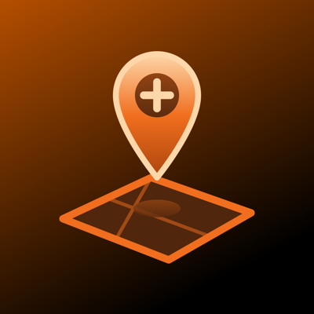</td>
<td align="center"><a href="https://github.com/specs-devs/packages/tree/main/CustomLocations">Custom Locations</a></td>
<td>Helpers for Custom Locations: activate content when the wearer is close and looking at a scanned place, plus a status panel and an example group.</td>
<td><code>git clone --filter=blob:none --sparse https://github.com/specs-devs/packages.git cd packages && git sparse-checkout add "CustomLocations"</code></td>
</tr>
<tr>
<td align="center">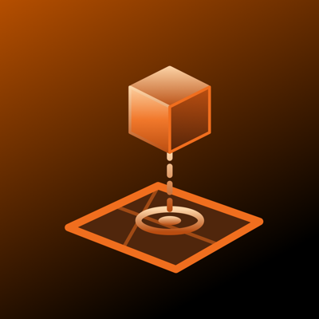</td>
<td align="center"><a href="https://github.com/specs-devs/packages/tree/main/AnchorExamples">Anchor Examples</a></td>
<td>Native AnchorModule wrapper and a persistent-widgets example: create, save, resolve and track spatial anchors across sessions.</td>
<td><code>git clone --filter=blob:none --sparse https://github.com/specs-devs/packages.git cd packages && git sparse-checkout add "AnchorExamples"</code></td>
</tr>
<tr>
<td align="center"></td>
<td align="center"><a href="https://github.com/specs-devs/packages/tree/main/Utilities">Utilities</a></td>
<td>Comprehensive utility library for scene object management, math operations, animations, and type conversions.</td>
<td><code>git clone --filter=blob:none --sparse https://github.com/specs-devs/packages.git cd packages && git sparse-checkout add "Utilities"</code></td>
</tr>
<tr>
<td align="center"></td>
<td align="center"><a href="https://github.com/specs-devs/packages/tree/main/SnapDecorators">Decorators</a></td>
<td>TypeScript decorators for simplified event binding and dependency injection to reduce boilerplate code.</td>
<td><code>git clone --filter=blob:none --sparse https://github.com/specs-devs/packages.git cd packages && git sparse-checkout add "SnapDecorators"</code></td>
</tr>
<tr>
<td align="center">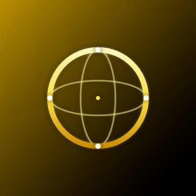</td>
<td align="center"><a href="https://github.com/specs-devs/packages/tree/main/RuntimeGizmos">Gizmos</a></td>
<td>Collections of line based tools for debugging or visualization.</td>
<td><code>git clone --filter=blob:none --sparse https://github.com/specs-devs/packages.git cd packages && git sparse-checkout add "RuntimeGizmos"</code></td>
</tr>
<tr>
<td align="center"></td>
<td align="center"><a href="https://github.com/specs-devs/packages/tree/main/EasyTeleprompter">Easy Teleprompter</a></td>
<td>Teleprompter lens for rehearsal and live public speaking with text display in field of view.</td>
<td><code>git clone --filter=blob:none --sparse https://github.com/specs-devs/packages.git cd packages && git sparse-checkout add "EasyTeleprompter"</code></td>
</tr>
<tr>
<td align="center"></td>
<td align="center"><a href="https://github.com/specs-devs/packages/tree/main/CompositeCameraTexture">Composite View</a></td>
<td>Advanced camera texture compositing and blending system.</td>
<td><code>git clone --filter=blob:none --sparse https://github.com/specs-devs/packages.git cd packages && git sparse-checkout add "CompositeCameraTexture"</code></td>
</tr>
<tr>
<td align="center"></td>
<td align="center"><a href="https://github.com/specs-devs/packages/tree/main/CropCameraTexture">Crop Camera Texture</a></td>
<td>Camera texture cropping and region selection tools.</td>
<td><code>git clone --filter=blob:none --sparse https://github.com/specs-devs/packages.git cd packages && git sparse-checkout add "CropCameraTexture"</code></td>
</tr>
<tr>
<td align="center">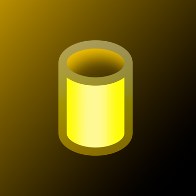</td>
<td align="center"><a href="https://github.com/specs-devs/packages/tree/main/VolumetricLine">Volumetric Line</a></td>
<td>Advanced volumetric line rendering system for 3D graphics.</td>
<td><code>git clone --filter=blob:none --sparse https://github.com/specs-devs/packages.git cd packages && git sparse-checkout add "VolumetricLine"</code></td>
</tr>
<tr>
<td align="center">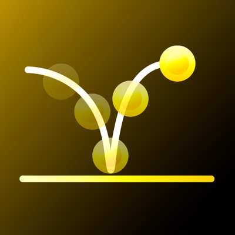</td>
<td align="center"><a href="https://github.com/specs-devs/packages/tree/main/AnimationExamples">Animation Examples</a></td>
<td>Native AnimationPlayer tween examples — scale, opacity, push-Z, squish, and timeline-driven animations driven from script.</td>
<td><code>git clone --filter=blob:none --sparse https://github.com/specs-devs/packages.git cd packages && git sparse-checkout add "AnimationExamples"</code></td>
</tr>
<tr>
<td align="center">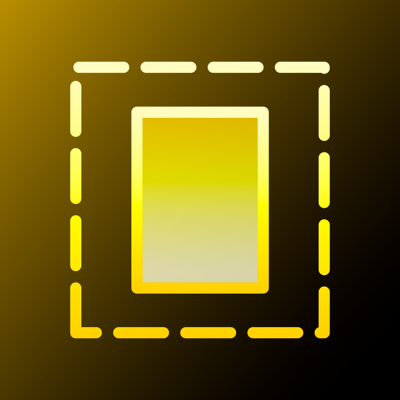</td>
<td align="center"><a href="https://github.com/specs-devs/packages/tree/main/MarkerTrackingHelper">Marker Tracking Helper</a></td>
<td>Provides Marker Tracking Examples.</td>
<td><code>git clone --filter=blob:none --sparse https://github.com/specs-devs/packages.git cd packages && git sparse-checkout add "MarkerTrackingHelper"</code></td>
</tr>
<tr>
<td align="center"></td>
<td align="center"><a href="https://github.com/specs-devs/packages/tree/main/ShaderLibrary">Shader Library</a></td>
<td>Collection of seven optimized shaders designed to enhance power efficiency without sacrificing visual quality.</td>
<td><code>git clone --filter=blob:none --sparse https://github.com/specs-devs/packages.git cd packages && git sparse-checkout add "ShaderLibrary"</code></td>
</tr>
<tr>
<td align="center"></td>
<td align="center"><a href="https://github.com/specs-devs/packages/tree/main/BezierLine">Bezier Line</a></td>
<td>Camera-facing cubic Bézier ribbon between two scene objects with runtime mesh generation.</td>
<td><code>git clone --filter=blob:none --sparse https://github.com/specs-devs/packages.git cd packages && git sparse-checkout add "BezierLine"</code></td>
</tr>
<tr>
<td align="center"></td>
<td align="center"><a href="https://github.com/specs-devs/packages/tree/main/Raymarching">Raymarching</a></td>
<td>Meshless, gooey metaballs drawn with a raymarched signed-distance-field shader: up to 8 sources merge into one glossy, stereo-correct surface.</td>
<td><code>git clone --filter=blob:none --sparse https://github.com/specs-devs/packages.git cd packages && git sparse-checkout add "Raymarching"</code></td>
</tr>
<tr>
<td align="center">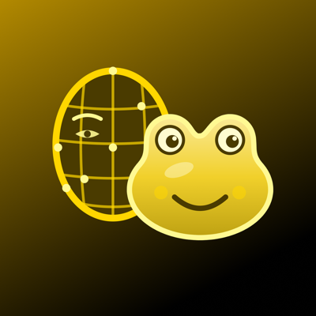</td>
<td align="center"><a href="https://github.com/specs-devs/packages/tree/main/FaceMeshExamples">Face Mesh Examples</a></td>
<td>Character heads on the faces you look at, following the head and copying expressions from the tracked Face Mesh.</td>
<td><code>git clone --filter=blob:none --sparse https://github.com/specs-devs/packages.git cd packages && git sparse-checkout add "FaceMeshExamples"</code></td>
</tr>
<tr>
<td align="center"></td>
<td align="center"><a href="https://github.com/specs-devs/packages/tree/main/VideoCallS2S">Video Call S2S</a></td>
<td>SPECS-to-SPECS video call: two SPECS wearers share POV video and voice.</td>
<td><code>git clone --filter=blob:none --sparse https://github.com/specs-devs/packages.git cd packages && git sparse-checkout add "VideoCallS2S"</code></td>
</tr>
<tr>
<td align="center"></td>
<td align="center"><a href="https://github.com/specs-devs/packages/tree/main/VideoCallS2M">Video Call S2M</a></td>
<td>SPECS-to-Mobile video call between a SPECS wearer and a friend's phone, peer-to-peer over WebRTC.</td>
<td><code>git clone --filter=blob:none --sparse https://github.com/specs-devs/packages.git cd packages && git sparse-checkout add "VideoCallS2M"</code></td>
</tr>
<tr>
<td align="center"></td>
<td align="center"><a href="https://github.com/specs-devs/packages/tree/main/FriendFinder">Friend Finder</a></td>
<td>Find a friend in a crowd, watch your own back, or video-call a friend — a SPECS + iPhone companion experience.</td>
<td><code>git clone --filter=blob:none --sparse https://github.com/specs-devs/packages.git cd packages && git sparse-checkout add "FriendFinder"</code></td>
</tr>
<tr>
<td align="center">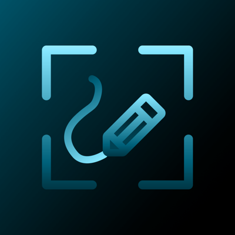</td>
<td align="center"><a href="https://github.com/specs-devs/packages/tree/main/RemoteAssistance">Remote Assistance</a></td>
<td>A helper in a web browser sees your POV, talks you through the task, and draws guidance that lands as 3D lines in your world.</td>
<td><code>git clone --filter=blob:none --sparse https://github.com/specs-devs/packages.git cd packages && git sparse-checkout add "RemoteAssistance"</code></td>
</tr>
<tr>
<td align="center">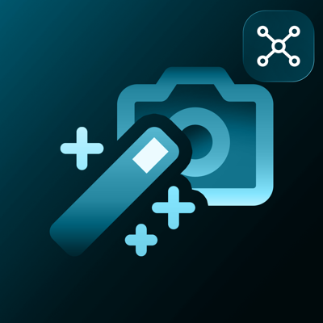</td>
<td align="center"><a href="https://github.com/specs-devs/packages/tree/main/DecartAI">Decart AI</a></td>
<td>Decart reality distortion on SPECS: the live camera feed runs through Decart's generative video models onto a floating screen.</td>
<td><code>git clone --filter=blob:none --sparse https://github.com/specs-devs/packages.git cd packages && git sparse-checkout add "DecartAI"</code></td>
</tr>
<tr>
<td align="center"></td>
<td align="center"><a href="https://github.com/specs-devs/packages/tree/main/NDKCapture">NDK Capture</a></td>
<td>Streaming and capture in one asset (SpecsNDK 1.1.0): stream camera, AR, UI and mic as separate layers, edit each one live, record them as separate tracks and re-edit the composite later.</td>
<td><code>git clone --filter=blob:none --sparse https://github.com/specs-devs/packages.git cd packages && git sparse-checkout add "NDKCapture"</code></td>
</tr>
</tbody>
</table>

---

## Core Frameworks Repository

Source of the frameworks at the heart of building for SPECS, as they ship in the Lens Studio Asset Library.

| Framework | Version | What it is |
|:--|:--|:--|
| [Interaction Kit](https://github.com/specs-devs/core-frameworks/tree/main/InteractionKit) | 4.0.0 | Hand, controller and phone interactions: interactors, interactables, targeting and manipulation. |
| [UI Kit](https://github.com/specs-devs/core-frameworks/tree/main/UIKit/Assets/UIKit.lspkg) | 4.0.0 | Components, layouts and themes for spatial interfaces. |
| [Motion](https://github.com/specs-devs/core-frameworks/tree/main/UIKit/Assets/Motion.lspkg) | 4.0.0 | The tween engine behind UI Kit. |
| [Sync Kit](https://github.com/specs-devs/core-frameworks/tree/main/SyncKit) | 4.0.0 | Shared, multi-user experiences with Connected Lenses. |
| [Leaf](https://github.com/specs-devs/core-frameworks/tree/main/Leaf) | 4.0.0 | Automated testing for Lenses with simulated hand input. |

---

## Icons Repository

The official SPECS iconography as a Lens Studio package: [every icon as a PNG](https://github.com/specs-devs/icons/tree/main/Icons/Assets/Icons.lspkg/Iconography), a packed icon atlas and the materials and scripts to place icons in a scene.

---

### Maintained with 👽 by the SPECS Team

